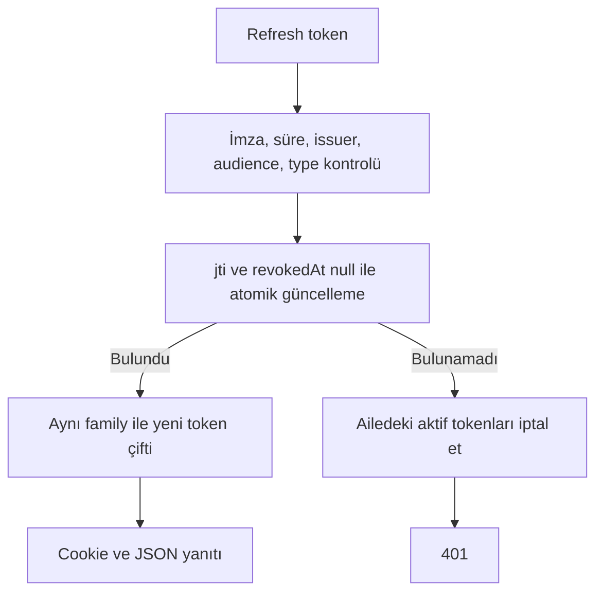

## Uç noktalar

| Metot | Yol | Gövde / yanıt |
|---|---|---|
| POST | `/api/auth/register` | Hesap oluşturur; 201, data.user |
| POST | `/api/auth/login` | email/password; token çifti ve user |
| POST | `/api/auth/refresh` | Cookie veya gövdede refreshToken; yeni çift |
| POST | `/api/auth/logout` | Auth cookie'lerini temizler |
| GET | `/api/auth/me` | Korumalı; güncel data.user |

Register alanları:

```json
{
  "email": "demo@example.org",
  "password": "example-password-123",
  "userName": "demo-user",
  "gender": "other",
  "age": 24
}
```

Email trim ve lowercase edilir. Parola 8–128, kullanıcı adı trim sonrası 3–20 karakterdir. `gender` ve `age` isteğe bağlıdır; yaş negatif olmayan tamsayıdır. Register otomatik giriş yapmaz.

## Parola ve JWT

Parola bcrypt cost=10 ile hash'lenir. Login doğru parola için access ve refresh JWT üretir. Her iki token aynı secret, issuer, audience ve kullanıcı subject'ini kullanır; `type` claim'i token'ın amacını ayırır.

Refresh token ayrıca rastgele `jti` ve oturum ailesi `family` içerir. MongoDB'de ham token yerine jti, kullanıcı, aile, bitiş tarihi ve iptal tarihi tutulur.

Bilinmeyen email, mevcut kullanıcı arama yordamından 404 alabilir; yanlış parola 401 olur. Bu mevcut davranıştır, bütün hataların tek tip döndüğü varsayılmamalıdır.

## Refresh algoritması



Atomik `findOneAndUpdate` aynı token'ın yalnızca bir kez döndürülmesini sağlar. İkinci kullanım, token çalınmış olabileceği varsayımıyla ailenin aktif token'larını iptal eder. Bu nedenle istemcinin aynı token'la paralel refresh göndermemesi önemlidir.

Mevcut web istemcisi aynı sayfa içindeki istekleri tek Promise ile birleştirir. Farklı sekmelerdeki eşzamanlı yenileme için paylaşılan kilit yoktur.

Refresh gövde örneği:

```json
{"refreshToken":"YOUR_REFRESH_TOKEN"}
```

Cookie varsa gövdeye göre önceliklidir. Hesabın hâlâ var olduğu ayrıca kontrol edilir. Süresi dolan MongoDB kayıtları TTL index ile temizlenir; TTL temizliğinin anlık olması beklenmez, JWT süre doğrulaması yine yapılır.

## Cookie davranışı

Access ve refresh cookie'leri `httpOnly`, `sameSite: strict` ve üretimde `secure` seçenekleriyle set edilir. Kod `maxAge` veya `expires` vermediği için cookie'nin tarayıcı oturum ömrü ile JWT'nin içindeki exp ayrı kavramlardır.

Farklı origin kullanan web/API için CORS origin listesi ve credentials gereklidir. Birbirinden farklı site alan adlarında SameSite=Strict cookie aktarımını engelleyebilir; CORS izni tek başına bunu çözmez.

## Logout sınırı

Logout cookie'leri siler; veritabanındaki refresh ailesini iptal etmez. Daha önce kopyalanmış geçerli bir token bu işlemle otomatik geçersiz hale gelmez. Bu davranış [sorun giderme ve sınırlamalarda](../operations/troubleshooting.md) dikkate alınmalıdır.

Kaynaklar: [token-service.ts](https://github.com/yagizerdem/DeuHackaton/blob/dev/apps/backend/src/services/token-service.ts), [auth-controller.ts](https://github.com/yagizerdem/DeuHackaton/blob/dev/apps/backend/src/controllers/auth-controller.ts).
