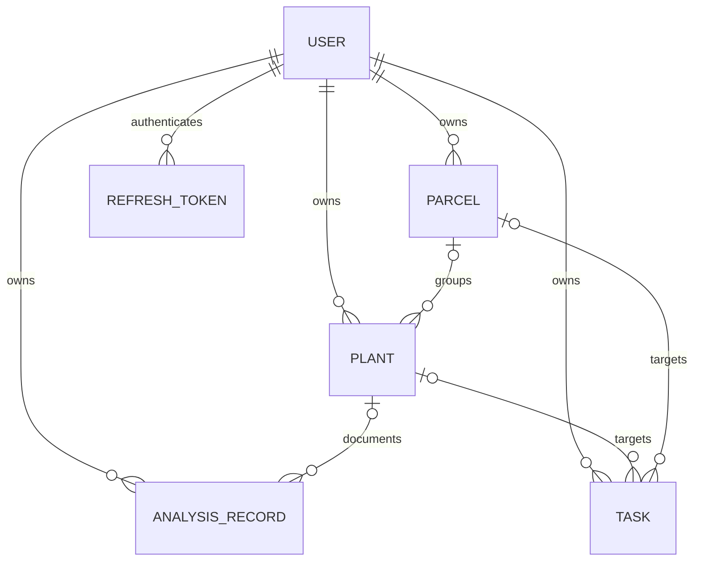

## MongoDB belgeleri

| Model | Temel alanlar | İlişkiler / index |
|---|---|---|
| User | email, userName, passwordHash, gender?, age? | email ve userName benzersiz |
| RefreshToken | user, jti, family, expiresAt, revokedAt? | jti benzersiz; user/family index; expiresAt TTL |
| Plant | owner, name, latinName?, tags, location?, parcelId?, photo? | owner index; isteğe bağlı Parcel |
| Parcel | owner, name, kind, polygon, notes? | owner index; field/garden |
| AnalysisRecord | owner, plantId?, mode, tags, analysis, assessment, sources | owner index; tanı snapshot'ı |
| Task | owner, title, dueDate, done, inProgress, repeat, plantId?, parcelId? | owner index; isteğe bağlı Plant/Parcel |

Mongoose şemaları timestamps üretir. HTTP DTO'larında MongoDB `_id` alanı string `id` olarak, tarihler ISO string olarak döner. Ham Mongoose belgelerinin tamamı istemciye açılmaz.

## Koordinat sözleşmeleri

Bitki noktası `{lat, lng}`, parsel köşesi `[lng, lat]` şeklindedir. Vejetasyon API'si boylam için `lon` kullanır. İstemci harita kitaplığına geçerken sıralamayı açıkça dönüştürmelidir.

Parsel halkası veritabanında kapatılmamış köşe listesi olarak tutulur. En az 3, en fazla 500 köşe doğrulanır; ilk noktayı sona eklemek zorunlu değildir. Şemadaki yorumlardan bağımsız olarak controller'ın halkayı otomatik kapattığı varsayılmamalıdır. Render ve geometri yardımcıları son köşeyi ilk köşeye bağlar.

## Fotoğraf saklama

Analiz yüklemesi bellekte işlenir ve tek başına kalıcı saklanmaz. Bitki fotoğrafı ise ayrı PUT isteğiyle MongoDB belgesinde Buffer ve MIME türü olarak tutulur.

`photo` alanı listelerde varsayılan olarak seçilmez. Fotoğraf endpoint'i açıkça `+photo` seçer ve JSON yerine görüntü byte'larını döndürür. URL'ye `photoUpdatedAt` sürümü eklenir; yanıt `private, max-age=86400` cache başlığı içerir.

## Silme davranışları

| İşlem | İlişkili veriler |
|---|---|
| Parsel silme | Bitki ve görevler tutulur; parcelId ilişkileri kaldırılır. |
| Bitki silme | Bağlı görevler silinir; analiz kayıtları tutulup plantId kaldırılır. |
| Analiz kaydı silme | Yalnızca ilgili snapshot silinir. |
| Görev silme | İlgili görev silinir; bütün tekrar ailesini silen ayrı mekanizma yoktur. |

Bu işlemler birkaç MongoDB yazısından oluşur; kodda transaction sınırı yoktur. Çok adımlı işlemlerin tümünün atomik olduğu varsayılmamalıdır.

## Snapshot ve güven sınırı

Analiz kaydının `analysis` ve `assessment` alanları oluşturulduktan sonra PATCH ile değiştirilemez; etiket ve bitki bağlantısı değiştirilebilir. Oluşturma verisi istemciden alınır ve şema doğrulanır. Bu doğrulama içeriğin gerçekten Gemini tarafından üretildiğini veya kaynakların güvenilir olduğunu kanıtlamaz.

Chroma bilgileri bu şemanın dışındadır. PDF yolu, sayfa numarası ve özet metadata; ham metin document; normalize embedding ise vektör alanında tutulur.

Kaynak: [Mongoose modelleri](https://github.com/yagizerdem/DeuHackaton/tree/dev/apps/backend/src/models), [ortak doğrulayıcılar](https://github.com/yagizerdem/DeuHackaton/blob/dev/packages/validators/src/farm-validators.ts).
