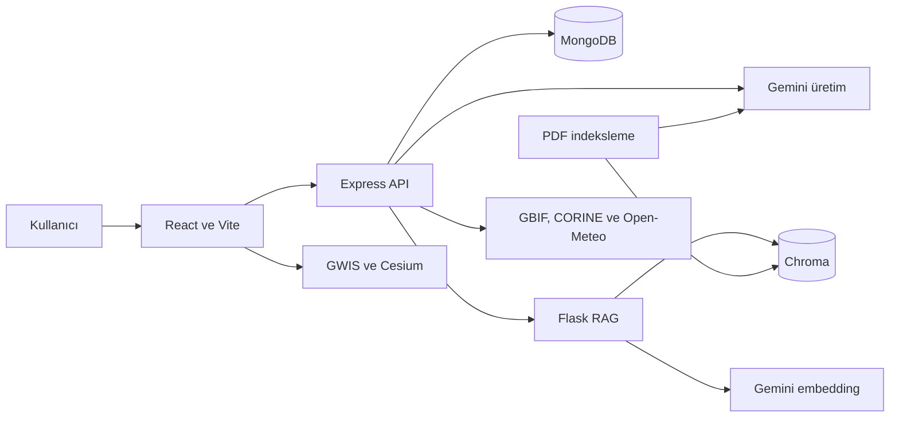
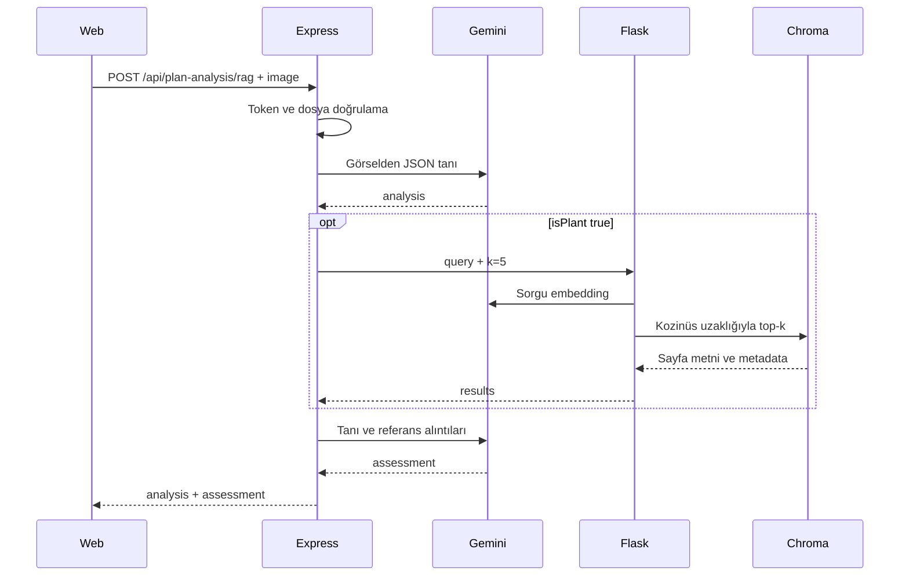

## Sorumluluklar

Uygulama bir npm monorepo, bağımsız bir Python servisi ve ayrı bir Docusaurus sitesinden oluşur. Express kimlik doğrulama, iş kuralları, MongoDB ve Gemini üretimini yönetir. Flask yalnızca PDF bilgi tabanının indeksine erişir. React, kullanıcı işlemlerini API'ye ve bazı harita isteklerini doğrudan dış sağlayıcılara iletir.

## İki farklı veri yolu

**Kalıcı iş verisi:** Kullanıcı → Express → MongoDB. Kullanıcı, bitki, parsel, görev ve analiz kaydı belgeleri tutulur. Kullanıcı kapsamı `owner` filtreleriyle uygulanır.

**Bilgi tabanı:** PDF → metin → özet → embedding → Chroma. Üretimde bir sorgu, Chroma'dan sayfa metinlerini alır. Bu indeks MongoDB'nin parçası değildir ve kullanıcı bazında ayrılmaz.

## Analiz isteğinin katmanları

Bu istekte MongoDB'ye analiz sonucu yazılmaz. Sonucu saklama ayrı bir API işlemidir.

## Bağımsız hata alanları

- MongoDB başlangıçta bağlanamazsa backend dinlemeye başlamaz.
- Gemini anahtarı olmadan backend başlayabilir; model isteyen işlemler hata verir.
- RAG çalışmasa da kimlik doğrulama ve çiftlik CRUD işlemleri çalışabilir.
- Vejetasyon analizinde dört kaynaktan biri çalışıyorsa kısmi yanıt üretilebilir.
- Dokümantasyon sitesi bu servislerden bağımsız statik HTML olarak derlenir.

## Uygulama ile prototipleri ayırma

`rag/model.ipynb` ilk araştırma not defteridir; canlı servis `ingest.py`, `store.py`, `app.py` ve `start.py` üzerinden çalışır. `plant_id/` deneyleri, mevcut Gemini analiz servisinin çağrı zincirinde değildir. Firebase yardımcı dosyalarının bulunması da mevcut auth akışının Firebase kullandığı anlamına gelmez; aktif auth JWT ve MongoDB tabanlıdır.

Kaynak: [Express uygulaması](https://github.com/yagizerdem/DeuHackaton/blob/dev/apps/backend/src/app.ts), [RAG servisi](https://github.com/yagizerdem/DeuHackaton/tree/dev/rag).
