## Bu projede RAG ne demek?

Retrieval-Augmented Generation, üretim modelinin yanıtını dışarıdan getirilen bilgiyle beslemektir. Bu projede dış bilgi PDF sayfalarıdır. Sistem modeli yeniden eğitmez, ağırlıklarını değiştirmez ve PDF'leri her istekte baştan okumaz.

İki ayrı yaşam döngüsü bulunur:

1. **Çevrimdışı indeksleme:** PDF sayfası → metin → bilimsel özet → embedding → kalıcı Chroma.
2. **İstek anı:** Görsel tanı → sorgu → sorgu embedding'i → yakın sayfalar → referanslı risk değerlendirmesi.

```mermaid
flowchart TD
  P[PDF sayfası] --> T[Ham metin]
  T --> S[Gemini bilimsel özeti]
  S --> E[Belge embedding]
  E --> C[(Chroma vektörü)]
  T --> C
  S --> C
  A[Görsel tanı] --> Q[Latin adlar ve belirtilerden sorgu]
  Q --> V[Sorgu embedding]
  V --> C
  C --> R[En yakın ham sayfalar]
  R --> X[Sayfa başına ilk 2000 karakter]
  A --> G[Gemini risk değerlendirmesi]
  X --> G
```

## Özet neden aranıyor?

Ham sayfalarda başlıklar, tablolar, tekrar eden metinler ve dağınık ifadeler bulunabilir. Özet prompt'u; tür, konukçu, coğrafya, belirtiler ve kontrol yöntemlerini düzenli başlıklarda toplar. Vektör, bu temsilden üretilir. Eşleşen kaydın `documents` alanında ise orijinal çıkarılmış sayfa metni bulunur.

Bu ayrımın amacı arama temsilini düzenlemek, üretim bağlamında kaynak metne dönmektir. Daha yüksek doğruluk sağladığı bu depoda ölçülmüş değildir. Özet bilgi kaybederse veya yanlış bilgi eklerse retrieval bundan etkilenir.

## “Multi-vector” tanımının kapsamı

README'de özet temelli multi-vector yaklaşımı ifadesi bulunur. Aktif kod sayfa başına **bir özet ve bir embedding** saklar. Bir sayfanın birden fazla chunk/özet/soru vektörüyle temsil edildiği bir multi-vector retriever veya ayrı parent document store uygulanmış değildir.

## Parçaların sorumluluğu

| Parça | Görev |
|---|---|
| `rag/ingest.py` | Sayfa çıkarma, özetleme işleri, batch upsert ve legacy taşıma |
| `rag/prompts.py` | Bilimsel İngilizce özet talimatı |
| `rag/store.py` | İstemci, retry, embedding, normalizasyon ve Chroma |
| `rag/app.py` | `/health` ve `/query`; üretim yanıtı yazmaz |
| Backend analiz servisi | Sorguyu kurar, referansları sınırlar, risk JSON'u üretir |
| Analiz controller'ı | Tanı → arama → değerlendirme sırasını yönetir |

## Uçtan uca örnek

Örnek bir tanıda `Platanus orientalis`, şüpheli `Corythucha ciliata` ve “yapraklarda beneklenme” belirtisi bulunursa sorgu bu alanların noktayla birleştirilmesidir. Bu sorgu, PDF özetleriyle aynı boyutta bir vektöre çevrilir. Chroma'nın döndürdüğü beş sayfa arasındaki metinler ikinci Gemini çağrısına eklenir.

Bu açıklama akış örneğidir; belirli bir PDF'nin mutlaka ilk sırada geleceği veya tanının doğru olduğu iddiası değildir. [Arama adımları](retrieval.md), [üretim bağlamı](generation.md) ve [değerlendirme yöntemi](evaluation.md) ayrı sayfalarda ele alınır.
